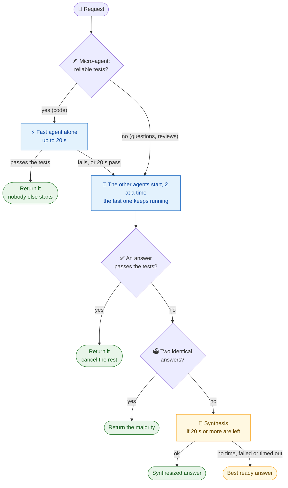

<div align="center">

# 🧩 Tessera

### A harness for coding agents.

One harness over **Claude Code**, **Codex**, **OpenClaw** and **Hermes**:<br>
same configuration, the same task in parallel, and the answer that **proves itself** instead of the one that sounds best.

<br>

[](https://github.com/dheiver2/tessera/actions/workflows/test.yml)


**🌐 [dheiver2.github.io/tessera](https://dheiver2.github.io/tessera/)**

[Quick start](#-quick-start) •
[How it decides](#-how-tessera-decides) •
[Commands](#%EF%B8%8F-commands) •
[Results](#-measured-results) •
[Gateway](#-gateway-optional) •
[Troubleshooting](#-troubleshooting) •
[Roadmap](#%EF%B8%8F-roadmap)

</div>

---

## 📌 In one sentence

Tessera **does not replace** your agents: it calls the CLIs you already have installed. The fastest agent answers first; if its answer **passes the tests**, that is the result and nobody else runs. Otherwise the others join and Tessera returns the first answer that passes, or the one most of them agree on. It only asks a model to synthesize when there is no other way to decide, and every task fits in a 150 s budget.

<table>
<tr>
<td width="25%" align="center">🔄<br><b>sync</b><br><sub>one configuration for all four agents</sub></td>
<td width="25%" align="center">⚡<br><b>fanout</b><br><sub>fast agent first; the answer that proves itself wins</sub></td>
<td width="25%" align="center">🔗<br><b>pipeline</b><br><sub>one agent's output feeds the next</sub></td>
<td width="25%" align="center">📊<br><b>eval</b><br><sub>each agent alone vs. Tessera</sub></td>
</tr>
</table>

> [!NOTE]
> Works with **any two or more** of the four agents: the ones that are not installed are skipped automatically. The eval task files are still in Portuguese.

---

## 🚦 Current status

> [!IMPORTANT]
> **On the hard set (33 tasks), over the latest 4 rounds the cascade averaged 26.75 correct vs. 25.75 for Claude, the best single agent: ahead in 3 rounds, behind in 1 (26 vs. 28).** Task by task it beat Claude 12 times and lost 8, which is not yet a statistically clear win (sign test p = 0.5); it is clearly ahead of Codex and Hermes. Its p95 is the 150 s time budget, within 1.5× the best agent's in 3 of the 4 rounds.

| Part | Status | Evidence |
|:---|:---:|:---|
| Sync (`sync`, `doctor`) | ✅ | Tests for idempotency, content preservation and conflicts |
| `pipeline`, `do`, task bus | ✅ | Tests with a fake agent (`test/fake-agent.mjs`) |
| `fanout`: verification, majority, synthesis, fallback | ✅ | Unit tests + real runs with the four agents |
| Per-branch deadline (kills the process group) | ✅ | Regression test: a grandchild sleeping 30 s no longer holds the fanout |
| Gateway-agnostic | ✅ | No gateway by default; any gateway via `~/.tessera/provider.json` or env vars |
| Claude Code · Codex · OpenClaw | ✅ | Answers in 6 to 36 s in the measured setup |
| Hermes | ⚠️ | The least stable: 11 to 27 correct per round |
| **Tessera better than each agent** | ⚠️ | Ahead on average (26.75 vs. 25.75 of 33) and in 3 of 4 rounds, Nov 6–7, 2026; against Claude, task by task, 12 wins and 8 losses: not yet a clear win. See [results](#-measured-results) |
| p95 latency ≤ 1.5× the best agent | ⚠️ | 3 of 4 rounds: 1.41×, 1.25×, 2.27× and 1.25× (150 s, the time budget; the 2.27× is against OpenClaw, tied for best in that round with a 66 s p95) |

---

## 🚀 Quick start

> **Requirements:** Node.js 22 or newer and at least two of `claude`, `codex`, `openclaw`, `hermes` installed and logged in. Nothing else to install.

Run it straight from GitHub:

```bash
npx github:dheiver2/tessera doctor
```

```bash
npx github:dheiver2/tessera fanout "What is the time complexity of binary search? One line."
```

`doctor` shows which agents it found and whether a gateway is configured. `fanout` sends the prompt to every installed agent and prints the chosen answer.

<details>
<summary><b>Install it locally instead</b></summary>

```bash
git clone https://github.com/dheiver2/tessera.git
cd tessera
npm test
npm link
```

After `npm link`, `tessera ...` works from any folder.
</details>

> [!TIP]
> **No gateway needed.** By default each agent uses its own login and configuration. Pointing all four at one gateway is optional: see [Gateway (optional)](#-gateway-optional).

---

## 🧠 How Tessera decides

The default is a **cascade**: one fast agent first, the others only when its answer cannot be confirmed.



| Path | When | In the 4 latest rounds |
|:---|:---|:---|
| ⚡ **Fast agent** | Its answer passes the tests (generated by the micro-agent, or your `--verify`) | 13 tasks, all right, p50 11 s |
| ✅ **Verification** | Another agent's answer passes | 6 tasks, 4 right |
| 🗳️ **Majority** | Two normalized answers match | 36 tasks, 33 right, p50 9 s |
| 🧪 **Synthesis** | Deadlock with 20 s or more left. With `--verify`, a **repair** from the failures | 57 tasks, 53 right, p50 44 s |
| ⏱️ **Best ready answer** | Budget almost over, or the synthesis failed: most votes, then most tests passed | 8 tasks, 4 right |
| ⛔ **One late answer, or none** | Only one agent answered within the budget, or none did | 12 tasks, none right |

Generated tests can be wrong, so they only speed up the choice: when no answer passes them, Tessera goes on as if there were no tests. Your own `--verify` command is trusted: when nothing passes it, the synthesis becomes a repair.

> [!TIP]
> **Why not always synthesize?** In the first measurement, the synthesis rewrote a correct solution and introduced a syntax error, and it accounted for half the latency. A model that rewrites is a weak selector. A test that passes is a strong one.

---

## 🛠️ Commands

### 🔄 `sync`: one configuration for everyone

The single source lives in the repository:

```text
core/AGENTS.md          shared rules
core/SOUL.md            identity
core/USER.md            user preferences
skills/<name>/SKILL.md  skills (name + description in the frontmatter)
mcp/servers.json        MCP servers (command/args/env or url)
framework.json          targets, routing, fanout and provider
```

```bash
tessera sync --dry-run --root ~/my-project
```

```bash
tessera sync --root ~/my-project
```

```bash
tessera sync --global --target claude,codex
```

| Target | Instructions | Persona | Skills | MCP |
|:---|:---|:---|:---|:---|
| **Claude Code** | `CLAUDE.md` | inside `CLAUDE.md` | `.claude/skills/` | `.mcp.json` |
| **Codex** | `AGENTS.md` | inside `AGENTS.md` | `.agents/skills/` | `.codex/config.toml` |
| **OpenClaw** | `AGENTS.md` (workspace) | `SOUL.md`, `USER.md` | `skills/` | snippet for `openclaw.json` |
| **Hermes** | `AGENTS.md` | `SOUL.md` | `skills/` | snippet for `config.yaml` |

<details>
<summary><b>🔒 Write guarantees</b></summary>

- Generated content sits between markers (`<!-- tessera:begin -->`). Anything you wrote outside them is left alone.
- Before changing an existing file, a copy goes to `~/.tessera/backups/<date>/`.
- Running again with no changes writes nothing.
- A hand-made skill (without the `.tessera-managed` marker) is only overwritten with `--force`.
- If an `[mcp_servers.<name>]` already exists outside the block, Tessera reports a conflict instead of duplicating it.

> [!NOTE]
> Paths follow each agent's convention. For OpenClaw and Hermes, MCP is emitted as a snippet: check it against your installed versions before applying.
</details>

### ⚡ `fanout`: everyone at once

```bash
tessera fanout "Does this function have a concurrency bug? <code>"
```

```bash
tessera fanout "Implement solve() in JS" --verify "node check.mjs"
```

The `--verify` command receives the answer on **stdin** and the agent name in `TESSERA_AGENT`. Exit code 0 means approved.

| Flag | Default | Purpose |
|:---|:---:|:---|
| `--agents a,b,c` | all installed | which agents to run |
| `--verify "cmd"` | — | verifier; the first approved answer wins |
| `--no-vote` | — | turns off majority voting |
| `--roles` | off | gives each agent a different focus |
| `--synth name` | `claude`, or the first installed | who synthesizes or repairs |
| `--deadline s` | `180` | per-branch deadline |
| `--synth-timeout s` | `180` | synthesis deadline |
| `--quorum n` · `--grace s` | `2` · `15` | with *n* good answers, wait *s* seconds and cancel the rest |
| `--max-wait s` | `30` | maximum wait after the first answer |
| `--max-concurrent n` | `2` | how many agents call the model at the same time; the rest wait in line |
| `--no-provider` | — | ignore any configured gateway for this run |
| `--no-cascade` | cascade on | run every agent at once instead of the fast agent first (its answer counts as a vote if the others are needed) |
| `--fast name` | `openclaw` | the fast agent for the cascade |
| `--hedge s` | `20` | how long the fast agent runs alone; after that the others start and it keeps running as one more branch |
| `--budget s` | `150` (`framework.json`) | total time per task, synthesis included; when it runs out, the best ready answer returns |
| `--no-auto-verify` | on with a gateway | skip generated tests; by default, with no `--verify`, a micro-agent writes test cases from the task (passing them speeds the choice, failing them forces nothing) |

<details>
<summary><b>🪶 Cascade and micro-agents</b></summary>

- **Cascade** (default since Nov 6, 2026: `"mode": "cascade"` in `framework.json > fanout`; `--no-cascade` turns it off): one agent answers first. If it passes verification, that answer returns and no other agent starts. If not, the others run, and the fast answer already counts as a vote, so one agreeing agent decides.
- **Hedge** (`hedgeSeconds`, 20 s; `--hedge`): if the fast agent has not answered by then, the others start and it keeps running as one more branch, holding one of the `maxConcurrent` slots. 20 s comes from the data: alone, OpenClaw answered 83% of the hard tasks within 20 s, and most of its later answers were wrong.
- **No wait when there is nothing to check:** with no verifier, or when the micro-agent found no reliable tests (questions and reviews, 19 of the 33 hard tasks), the fast answer can only be a vote, so the others start right away.
- **Time budget** (`budgetSeconds`, 150 s; `--budget`): counted from the start of the task. Branches are cut when it runs out, and the synthesis only gets the time left. With less than 20 s left, there is no synthesis: the best ready answer returns, the one most agents gave and, on a tie, the one that passed the most generated tests.
- **Micro-agent** (on by default when a gateway is configured, `"autoVerify": true`; `--no-auto-verify` turns it off): a short, single-purpose call straight to the gateway's `/chat/completions`, with no agent harness. It writes `{fn, cases:[{call, expect}]}` from the task, in parallel with the agents; answers run on those cases in the sandbox. Generated tests can be wrong, so they are *soft*: no answer passing them never forces a repair.
- **Three samples, kept only where they agree:** the micro-agent asks three times in parallel (temperature 0, 0.8 and 0.8) and keeps only the cases at least two samples wrote with the same expected value. With fewer than 3 such cases there is no reliable test.
- Model: `models.micro`, else `model`. Extra body fields go in `microParams`, for what your gateway accepts (for example `{"chat_template_kwargs": {"enable_thinking": false}}` turns off reasoning on vLLM/Qwen: about 2 s per call instead of 18 s). With no gateway, the micro-agent falls back to `microAgent` through its CLI, with one sample.

| Micro-agent (14 hard code tasks, real answers from earlier rounds) | Correct code passes | Wrong code rejected | Ready in (p50) |
|:---|:---:|:---:|:---:|
| One sample | 68% | 87% | 0.3 s |
| **Three samples, cases where two agree** | **79%** | **91%** | 3.6 s |
</details>

<details>
<summary><b>⏱️ How latency is bounded</b></summary>

- **Worst case:** the time budget (`budgetSeconds`, 150 s in `framework.json`), synthesis included, even with a stuck agent. With no budget, `deadline + synth-timeout`.
- Each branch runs in **its own process group**. On timeout or cancellation, the whole group gets SIGTERM and, 3 s later, SIGKILL. An agent's child processes can no longer hold the fanout open.
- A branch that times out becomes a failure, and the fanout continues with the others. The fanout only fails if **none** of them answer.
- Each answer is truncated to `maxCharsPerBranch` (6000) before synthesis.

Output format with `--verify` (shortened ids):

```text
[done] openclaw 10912ms (…)  verification: passed
[cancelled] claude 11020ms (…)  — dismissed (an answer was already chosen)
[cancelled] codex 11024ms (…)  — dismissed (an answer was already chosen)
[cancelled] hermes 11031ms (…)  — dismissed (an answer was already chosen)
branches: 11031ms  gateway: each agent's own

=== final answer (openclaw passed verification, no synthesis, 11040ms total) ===
```
</details>

### 🔗 `pipeline`: chain agents

`{{previous}}` is replaced with the previous step's output. The pipeline **stops at the first failing step**.

```json
{
  "steps": [
    { "name": "analysis", "agent": "codex",  "prompt": "List correctness risks in the code." },
    { "name": "review",   "agent": "claude", "prompt": "Confirm or dismiss each point:\n\n{{previous}}" },
    { "name": "summary",  "agent": "hermes", "prompt": "Summarize in 10 lines:\n\n{{previous}}" }
  ]
}
```

```bash
tessera pipeline pipelines/revisar-e-resumir.json
```

### 🎯 `do` and `delegate`: a single agent

```bash
tessera do --kind code "implement function X in src/x.js"
```

```bash
tessera delegate --agent codex "explain this error"
```

`do` picks the agent by task kind (`framework.json > routing`):

| Kind | `code` | `review` | `summary` | `automation` |
|:---|:---:|:---:|:---:|:---:|
| Agent | Codex | Claude | Hermes | OpenClaw |

> [!WARNING]
> This routing is still a **hypothesis**, not a measurement. Eval data will replace it (Phase 3 of the [plan](docs/PLANO.md)).

### 📊 `eval`: measure instead of assume

Runs the same tasks on each agent alone and on Tessera, grades them **without using a model**, and compares.

```bash
tessera eval
```

```bash
tessera eval --tasks evals/tasks-dificeis.json
```

```bash
tessera eval --limit 5 --kind code --modes openclaw,tessera
```

| Set | Tasks | Code | Questions | Review |
|:---|:---:|:---:|:---:|:---:|
| [`evals/tasks.json`](evals/tasks.json) | 34 | 14 | 14 | 6 |
| [`evals/tasks-dificeis.json`](evals/tasks-dificeis.json) (hard) | 33 | 14 | 11 | 8 |

<details>
<summary><b>🧪 How grading works</b></summary>

- **Code:** the `solve` function runs against tests. Tessera **only sees the first half** of the tests for verification; the grade uses **all of them**, so verification cannot become cheating.
- **Questions:** accept and reject regexes (catches traps like `9.11 > 9.9`).
- **Review:** the known bug must be pointed out.
- **Sandbox:** `node --permission`, read access only to its own file, no network, no child processes, minimal environment (no process variable leaks) and a fixed time zone.
- **Forbidden patterns:** tasks such as the expression parser fail if they use `eval` or `Function`.
- **Hard set:** every task has a reference solution that passes and, where it makes sense, a naive solution that fails (`test/eval-dificeis.test.mjs`).
- **Sequential execution** by default, so one mode's latency does not inflate another's.
- **Output:** `evals/resultados/<date>.json` and `.md`, with accuracy per mode and per kind, p50/p95, oracle, decision path, and tasks won and lost.
</details>

---

## 📈 Measured results

> Measured with all four agents on the same model (`mangaba-agente-rapido`) through one gateway (the author's Mangaba Router), so differences come only from each agent's harness. Synthesis by Claude. A single agent varies by up to 7 tasks between rounds (Hermes, 17 to 24), so compare means over several rounds and pair results by task.

### ⏱️ Hard set · cascade with hedge and time budget vs. single agents, same round · Nov 6–7, 2026 · 4 rounds

What changed since the two rounds below: the fast agent gets 20 s alone (hedge), the others start at once when there is nothing to check, each task has a 150 s budget with the best ready answer as the fallback, and the micro-agent combines three samples (see [Cascade and micro-agents](#-fanout-everyone-at-once)).

| Mode | Round 3 | Round 4 | Round 5 | Round 6 | Mean (of 33) | Answered | p95 |
|:---|:---:|:---:|:---:|:---:|:---:|:---:|---:|
| 🪶 **cascade** | **25** | **29** | **27** | 26 | **26.75** | **125/132** | 150 s |
| claude | 23 | 27 | 25 | **28** | 25.75 | 118/132 | 120 s |
| openclaw | 23 | 25 | 25 | 23 | 24.00 | 121/132 | 66–120 s |
| codex | 21 | 24 | 20 | 19 | 21.00 | 109/132 | 120 s |
| hermes | 19 | 17 | 24 | 18 | 19.50 | 93/132 | 122 s |

> [!IMPORTANT]
> **Verdict: ahead on average, not yet a clear win over Claude.** The cascade's mean is 1.0 task above Claude's, the best single agent in every round (tied with OpenClaw in rounds 3 and 5), and 2.75 above OpenClaw's. It was 2 tasks ahead of each round's best agent in rounds 3 to 5 and 2 behind in round 6. Task by task over the 132 task-rounds, against Claude it won 12 and lost 8 (sign test p = 0.5); against OpenClaw, 19 and 8 (p = 0.05); against Codex, 30 and 7, and Hermes, 34 and 5 (both p < 0.001). p95 is the 150 s budget in every round: 1.41×, 1.25×, 2.27× and 1.25× the best agent's, down from 2.1–2.2× in the two rounds below; the 2.27× is against OpenClaw, tied for best in round 5 with a 66 s p95 (1.25× against Claude, the other tied agent). Over the four rounds, majority decided 36 tasks (33 right, p50 9 s), the fast agent 13 (all right, 11 s) and synthesis 57 (53 right, 44 s).
>
> It missed 15 tasks that some agent alone got right and got 3 that none did. Of the 15: 5 ran out of the budget before that agent answered (in 2, a stalled fast agent held one of the two slots for 120 s); 5 are questions (in 3, two agents on the same model agreed on the same wrong answer; in 2, synthesis picked the wrong one); 2 are code tasks where, after two wrong answers, the 15 s grace cut the agents that would have been right; 2 are code tasks where synthesis failed and the fallback took the first agent in order instead of the right answer that was ready; 1 is a task only OpenClaw solves alone, which it got wrong inside the cascade. Raw: `evals/resultados/2026-11-06T23-44-22-578Z.json`, `2026-11-07T01-52-45-762Z.json`, `2026-11-07T03-41-24-886Z.json` and `2026-11-07T05-39-23-068Z.json`.

### 📜 How we got here

Every step was kept only if it held up against the single agents in the same round.

| Date | Change | Result |
|:---|:---|:---|
| Nov 5 | Phase 0: always synthesize (34 original tasks) | Tied with OpenClaw at 33/34; the synthesis broke a correct answer and took half the time |
| Nov 5 | Phase 1: verification → majority → synthesis | Code 14/14, p50 55 s → 23 s. OpenClaw hit 34/34: the set had a ceiling, so the hard set was written |
| Nov 5–6 | Hard set, per-branch deadline fixed (4 rounds) | Tied with OpenClaw, 26.0 vs. 26.3; 14% of tasks with no answer because the router stalled |
| Nov 6 | Queue: at most 2 agents at once | No answer 10% → 6%; accuracy still tied; p95 3.0× the best agent |
| Nov 6 | Cascade + generated tests becomes the default (2 rounds) | 27.5 vs. 26.0 mean; 65/66 answered; p95 2.1–2.2× |
| Nov 6–7 | Hedge, 150 s budget, three-sample tests (4 rounds) | 26.75 vs. 25.75 for Claude; p95 within 1.5× in 3 of 4 rounds |

Every round in detail, with decision paths and the tasks won and lost: [`docs/RESULTS.md`](docs/RESULTS.md). Raw files: [`evals/resultados/`](evals/resultados/); aggregation script: [`evals/agregar.mjs`](evals/agregar.mjs).

<details>
<summary><b>🩹 What the measurements changed in the code</b></summary>

| Problem found | Fix |
|:---|:---|
| Synthesis rewrote correct answers | Selection by verification and majority; synthesis only on deadlock |
| A synthesis timeout left the fanout empty | Fallback to a finished branch |
| Roles changed the format of objective answers | Roles off by default (`--roles`) |
| Agent subprocesses held the fanout past the deadline | Own process group + SIGKILL on the group |
| User plugins and hooks contaminated Claude | `--bare` when a provider is set |
| `--tools ""` swallowed Claude's prompt | Prompt via stdin |
| Two runs in the same session hung OpenClaw | New `--session-id` per call |
| OpenClaw logs ended up in the answer | Strip `[subsystem] ...` lines |
| OpenClaw said "couldn't generate a response" with exit code 0 | Treated as a failure |
| Codex with `mangaba-coder` returned an empty message | Model switched to `mangaba-agente-rapido` |
| Hermes hung with `mangaba-flash` | Model switched; reasoning hidden in `config.yaml` |
</details>

---

## ⚙️ Configuration

### 🌐 Gateway (optional)

Tessera is gateway-agnostic. With no configuration, each agent runs with **its own login and settings**. To run all four through one gateway (LiteLLM, OpenRouter, a self-hosted router...), Tessera looks for the configuration in this order:

| Order | Source | Tracked in git? |
|:---:|:---|:---:|
| 1 | the file in `TESSERA_PROVIDER_FILE` | no |
| 2 | `~/.tessera/provider.json` | no |
| 3 | `"provider"` in `framework.json` | yes (empty by default) |
| 4 | only env vars: `TESSERA_PROVIDER_BASE_URL` + `TESSERA_PROVIDER_KEY` (+ `TESSERA_MODEL`) | no |

The fastest way:

```bash
export TESSERA_PROVIDER_BASE_URL="https://your-gateway/v1"
export TESSERA_PROVIDER_KEY="..."
export TESSERA_MODEL="your-model"
```

For per-agent models and options, copy [`examples/provider.example.json`](examples/provider.example.json) to `~/.tessera/provider.json`:

| Field | Purpose |
|:---|:---|
| `baseUrl` | OpenAI-compatible endpoint, used by Codex, OpenClaw and Hermes |
| `anthropicBaseUrl` | Anthropic-compatible endpoint for Claude Code (default: `baseUrl` without `/v1`) |
| `keyEnv` · `keyFile` | where the key comes from (default `TESSERA_PROVIDER_KEY`, then `~/.tessera/provider.key`) |
| `model` · `models.<agent>` | one model for all, or one per agent |
| `codexWireApi` | `responses` (default) or what your Codex version and gateway support |
| `hermesProvider` | id of the provider entry in Hermes' `config.yaml` |
| `contextTokens` | context limit passed to Claude Code |

How each agent is pointed at the gateway, without changing its global configuration:

| Agent | Mechanism |
|:---|:---|
| **Claude Code** | `--bare`; `ANTHROPIC_BASE_URL` and `ANTHROPIC_API_KEY` only in the child process; prompt via stdin; `--tools ""` |
| **Codex** | `-c model_provider=tessera` and `-c model_providers.tessera.*` on the command line |
| **OpenClaw** | `--model <provider>/<model>` and a new `--session-id` per call |
| **Hermes** | `--provider <hermesProvider>` and `-m <model>` |

> [!NOTE]
> Claude Code needs a gateway that speaks the Anthropic Messages API; the other three use the OpenAI format. OpenClaw and Hermes also need the gateway registered once in their own config (`openclaw.json`, Hermes' `config.yaml`). `--no-provider` ignores any gateway for one run.

> [!CAUTION]
> Keys **never** go into the repository. `~/.tessera/` lives outside it; keep key files at mode 600.

### 🔧 Change an agent's command

Set `TESSERA_<AGENT>_CMD`. The prompt is appended as the last argument. For arguments with spaces or quotes, use JSON:

```bash
export TESSERA_CODEX_CMD="codex exec --skip-git-repo-check --full-auto"
```

```bash
export TESSERA_CLAUDE_CMD='["claude", "-p", "--tools", ""]'
```

<details>
<summary><b>Default command for each agent</b></summary>

| Agent | Without gateway | With gateway |
|:---|:---|:---|
| claude | `claude -p --tools ""` (stdin) | `claude --bare -p --tools ""` (stdin) |
| codex | `codex exec --skip-git-repo-check <prompt>` | same + `-c model_provider=tessera ...` and `-m <model>` |
| openclaw | `openclaw agent --local --agent main --session-id <new> --thinking off --message <prompt>` | same + `--model <model>` |
| hermes | `hermes chat -Q -q <prompt>` | same + `--provider <hermesProvider> -m <model>` |

- **Claude without tools:** with the default tools, the initial prompt is large and dominates the time. For tasks that need tools, change the command.
- **OpenClaw needs an agent:** pass `--agent-id main` (or your id) to any command.
</details>

---

## 🩺 Troubleshooting

| Symptom | Likely cause | What to do |
|:---|:---|:---|
| `OAuth session expired` in Claude | expired login | run `claude` and sign in again, or use a gateway |
| `401` from the gateway | invalid or revoked key | update `TESSERA_PROVIDER_KEY` or your `keyFile` |
| `Not inside a trusted directory` in Codex | folder outside a git repository | already handled: the adapter passes `--skip-git-repo-check` |
| `Pass --to ... or --agent` in OpenClaw | missing agent id | pass `--agent-id main` |
| `Agent couldn't generate a response` | OpenClaw got no answer from the model | treated as a failure; the fanout continues with the others |
| `could not run "hermes"` / `skipping hermes (not installed)` | CLI not on PATH | install it, set `TESSERA_HERMES_CMD`, or just run with the others |
| `timed out after Ns` | slow agent or gateway | raise `--deadline` or drop the agent with `--agents` |
| `conflict` in `sync` | duplicate `[mcp_servers.x]` outside the block | remove the duplicate definition by hand |

The run history lives in `.tessera/bus/tasks/*.json`, with status, output, error and duration:

```bash
tessera tasks
```

---

## 🗺️ Roadmap

| | Step | Status |
|:---:|:---|:---|
| ✅ | **Phase 0**: measure before optimizing (`eval`) | Done |
| ✅ | **Phase 1**: selection by verification and majority | Implemented, without worktrees |
| ✅ | Hard set, 4 rounds with the deadline fix | Done: tie, 26.0 vs. 26.3 |
| ✅ | Fanout queue (at most 2 branches at once) and per-branch deadline | Done: no answer 10% → 6% |
| ✅ | Cascade with generated tests as the default | Done: 27.5 of 33, above every agent's mean |
| ✅ | Latency: hedge, time budget, three-sample tests | Done: p95 is the 150 s budget, within 1.5× of the best agent in 3 of 4 rounds |
| ⏭️ | A clear win over the best agent (today +1.0 per round, p = 0.5 against Claude): compare code answers by behavior on the generated tests, free the slot of a stalled fast agent, check questions about a JavaScript expression by running it | Next: being measured |
| ⏭️ | Stricter majority (no 2 × 2 ties) and a check on single answers | Later |
| ⏭️ | **Phase 2**: free-text agreement without synthesis | Planned |
| ⏭️ | **Phase 3**: routing learned from eval data | Planned |
| ⏭️ | **Phase 4**: per-agent circuit breaker | Planned |
| ⏭️ | git worktrees for agents that edit files | Planned |

The full plan, with done criteria, is in [`docs/PLANO.md`](docs/PLANO.md) (in Portuguese).

---

## 📁 Layout

```text
tessera/
├── bin/tessera.mjs          CLI
├── src/
│   ├── bridge.mjs           agents, fanout, cascade, verification, majority, synthesis
│   ├── microagents.mjs      micro-agents: generated tests, straight to the gateway
│   ├── sandbox.mjs          runs answers on test cases with node --permission
│   ├── eval.mjs             tasks, grading and report
│   ├── adapters/            how each agent is called
│   └── sync.mjs · writer.mjs · canonical.mjs
├── core/ · skills/ · mcp/   single source of configuration
├── evals/
│   ├── tasks.json           34 tasks
│   ├── tasks-dificeis.json  33 tasks with traps (hard set)
│   └── resultados/          .json and .md report for each round
├── pipelines/               pipeline examples
├── examples/                gateway configuration example
├── docs/                    PLANO.md (phased plan) · RESULTS.md (every round)
├── .github/workflows/       tests on Node 22 and 24 on every push
└── test/                    90 tests (node:test)
```

---

<div align="center">

**MIT** · made by [@dheiver2](https://github.com/dheiver2)

</div>
