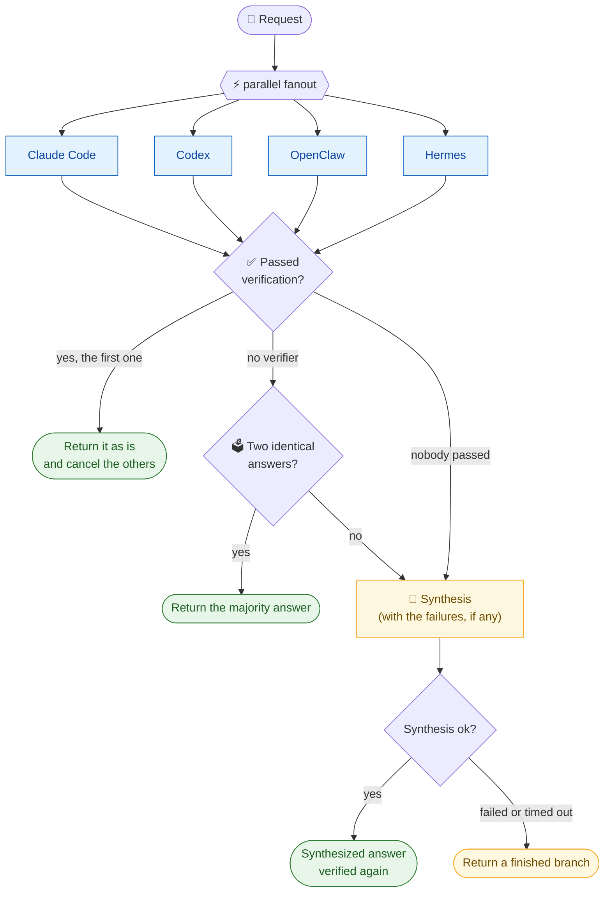

<div align="center">

# 🧩 Tessera

### One source, many agents, one result.

Runs **Claude Code**, **Codex**, **OpenClaw** and **Hermes** as if they were one:<br>
same configuration, the same task in parallel, and the answer that **proves itself** instead of the one that sounds best.

<br>


**🌐 [dheiver2.github.io/tessera](https://dheiver2.github.io/tessera/)**

[Quick start](#-quick-start) •
[How it decides](#-how-tessera-decides) •
[Commands](#%EF%B8%8F-commands) •
[Results](#-measured-results) •
[Configuration](#%EF%B8%8F-configuration) •
[Troubleshooting](#-troubleshooting) •
[Roadmap](#%EF%B8%8F-roadmap)

</div>

---

## 📌 In one sentence

Tessera **does not replace** your agents: it calls the CLIs you already have installed, sends the same task to all of them and returns the first answer that **passes the tests**. When there is no test, it returns the answer most of them agree on. It only asks a model to synthesize when there is no other way to decide.

<table>
<tr>
<td width="25%" align="center">🔄<br><b>sync</b><br><sub>one configuration for all four agents</sub></td>
<td width="25%" align="center">⚡<br><b>fanout</b><br><sub>all in parallel, the one that proves itself wins</sub></td>
<td width="25%" align="center">🔗<br><b>pipeline</b><br><sub>one agent's output feeds the next</sub></td>
<td width="25%" align="center">📊<br><b>eval</b><br><sub>each agent alone vs. Tessera</sub></td>
</tr>
</table>

> [!NOTE]
> The CLI messages and the task files are currently in Portuguese. Commands, flags and outputs are shown below exactly as they are.

---

## 🚦 Current status

> [!IMPORTANT]
> **Over 4 rounds of the hard task set, Tessera ties the best single agent: 26.0 vs. 26.3 for OpenClaw (out of 33).** When it reaches a decision, it is right 93% of the time; it loses on the 14% of tasks where no branch finishes in time. That is the next target.

| Part | Status | Evidence |
|:---|:---:|:---|
| Sync (`sync`, `doctor`) | ✅ | Tests for idempotency, content preservation and conflicts |
| `pipeline`, `do`, task bus | ✅ | Tests with a fake agent (`test/fake-agent.mjs`) |
| `fanout`: verification, majority, synthesis, fallback | ✅ | Unit tests + real runs with the four agents |
| Per-branch deadline (kills the process group) | ✅ | Regression test: a grandchild sleeping 30 s no longer holds the fanout |
| Single shared provider (Mangaba Router) | ✅ | All four agents run through it, no per-agent login |
| Claude Code · Codex · OpenClaw | ✅ | `mangaba-agente-rapido`, answers in 6 to 36 s |
| Hermes | ⚠️ | The least stable: 11 to 27 correct per round |
| **Tessera better than each agent** | 🟨 **Tie** | 26.0 vs. 26.3 for OpenClaw, average of 4 rounds. See [results](#-measured-results) |
| p95 latency ≤ 1.5× the best agent | ❌ | 3.7× (180 s vs. 49 s) |

---

## 🚀 Quick start

> **Requirements:** Node.js 20 or newer. Nothing to install.

```bash
git clone https://github.com/dheiver2/tessera.git
cd tessera
npm test
```

```bash
node bin/tessera.mjs doctor
```

```bash
node bin/tessera.mjs fanout --no-provider --prompt "What is the time complexity of binary search? Answer in 1 line."
```

<details>
<summary><b>Make the <code>tessera</code> command available in your terminal</b></summary>

```bash
npm link
```

After that, `tessera fanout ...` works from any folder.
</details>

<details>
<summary><b>Use one OpenAI-compatible router as the provider for all four agents</b></summary>

By default the repo points the four agents at the Mangaba Router (`framework.json > provider`). To use each agent's own login and configuration instead, pass `--no-provider` or remove the `provider` block. To use another OpenAI-compatible router, change `baseUrl` and the model names.

The key comes from `MANGABA_ROUTER_KEY` or, if unset, from `~/.tessera/router.key`. The file lives outside the repository, with mode 600.

```bash
mkdir -p ~/.tessera && chmod 700 ~/.tessera
```

```bash
read -rs MANGABA_ROUTER_KEY && printf %s "$MANGABA_ROUTER_KEY" > ~/.tessera/router.key && chmod 600 ~/.tessera/router.key
```

> [!CAUTION]
> The key **never** goes into the repository.
</details>

---

## 🧠 How Tessera decides



| Order | Path | When | Cost |
|:---:|:---|:---|:---|
| 1️⃣ | **Verification** | There is a `--verify "cmd"` (in the eval, the task's public tests) | Cheapest: the first approved answer ends the fanout |
| 2️⃣ | **Majority** | No verifier, and two normalized answers match | Cheap: no extra model call |
| 3️⃣ | **Synthesis** | Deadlock. With a verifier, it becomes a **repair** from the failures | Most expensive: one more call |
| 🛟 | **Fallback** | The synthesis failed or timed out | Returns a finished branch instead of nothing |

> [!TIP]
> **Why not always synthesize?** In the first measurement, the synthesis rewrote a correct solution and introduced a syntax error, and it accounted for half the latency. A model that rewrites is a weak selector. A test that passes is a strong one.

---

## 🛠️ Commands

### 🔄 `sync`: one configuration for everyone

The single source lives in the repository:

```text
core/AGENTS.md          shared rules
core/SOUL.md            identity
core/USER.md            user preferences
skills/<name>/SKILL.md  skills (name + description in the frontmatter)
mcp/servers.json        MCP servers (command/args/env or url)
framework.json          targets, routing, fanout and provider
```

```bash
node bin/tessera.mjs sync --dry-run --root ~/my-project
```

```bash
node bin/tessera.mjs sync --root ~/my-project
```

```bash
node bin/tessera.mjs sync --global --target claude,codex
```

| Target | Instructions | Persona | Skills | MCP |
|:---|:---|:---|:---|:---|
| **Claude Code** | `CLAUDE.md` | inside `CLAUDE.md` | `.claude/skills/` | `.mcp.json` |
| **Codex** | `AGENTS.md` | inside `AGENTS.md` | `.agents/skills/` | `.codex/config.toml` |
| **OpenClaw** | `AGENTS.md` (workspace) | `SOUL.md`, `USER.md` | `skills/` | snippet for `openclaw.json` |
| **Hermes** | `AGENTS.md` | `SOUL.md` | `skills/` | snippet for `config.yaml` |

<details>
<summary><b>🔒 Write guarantees</b></summary>

- Generated content sits between markers (`<!-- tessera:begin -->`). Anything you wrote outside them is left alone.
- Before changing an existing file, a copy goes to `~/.tessera/backups/<date>/`.
- Running again with no changes writes nothing.
- A hand-made skill (without the `.tessera-managed` marker) is only overwritten with `--force`.
- If an `[mcp_servers.<name>]` already exists outside the block, Tessera reports a conflict instead of duplicating it.

> [!NOTE]
> Paths follow each agent's convention. For OpenClaw and Hermes, MCP is emitted as a snippet: check it against your installed versions before applying.
</details>

### ⚡ `fanout`: everyone at once

```bash
node bin/tessera.mjs fanout --prompt "Does this function have a concurrency bug? <code>"
```

```bash
node bin/tessera.mjs fanout --prompt "Implement solve() in JS" --verify "node check.mjs"
```

The `--verify` command receives the answer on **stdin** and the agent name in `TESSERA_AGENT`. Exit code 0 means approved.

| Flag | Default | Purpose |
|:---|:---:|:---|
| `--agents a,b,c` | all four | which agents to run |
| `--verify "cmd"` | — | verifier; the first approved answer wins |
| `--no-vote` | — | turns off majority voting |
| `--roles` | off | gives each agent a different focus |
| `--synth name` | `claude` | who synthesizes or repairs |
| `--deadline s` | `120` | per-branch deadline |
| `--synth-timeout s` | `180` | synthesis deadline |
| `--quorum n` · `--grace s` | `2` · `15` | with *n* good answers, wait *s* seconds and cancel the rest |
| `--max-wait s` | `30` | maximum wait after the first answer |
| `--no-provider` | — | use each agent's own configuration |

<details>
<summary><b>⏱️ How latency is bounded</b></summary>

- **Worst case:** `deadline + synth-timeout`, even with a stuck agent.
- Each branch runs in **its own process group**. On timeout or cancellation, the whole group gets SIGTERM and, 3 s later, SIGKILL. An agent's child processes can no longer hold the fanout open.
- A branch that times out becomes a failure, and the fanout continues with the others. The fanout only fails if **none** of them answer.
- Each answer is truncated to `maxCharsPerBranch` (6000) before synthesis.

Output format with `--verify` (shortened ids; the CLI currently prints in Portuguese):

```text
[done] openclaw 10912ms (…)  verificação: passou
[cancelled] claude 11020ms (…)  — dispensado (já havia resposta escolhida)
[cancelled] codex 11024ms (…)  — dispensado (já havia resposta escolhida)
[cancelled] hermes 11031ms (…)  — dispensado (já havia resposta escolhida)
ramos: 11031ms  provedor: mangaba-router

=== resposta final (openclaw passou na verificação, sem síntese, 11040ms no total) ===
```

That reads: OpenClaw passed verification after 10.9 s, the other three were dismissed, and the final answer came back with no synthesis in 11 s total.
</details>

### 🔗 `pipeline`: chain agents

`{{previous}}` is replaced with the previous step's output. The pipeline **stops at the first failing step**.

```json
{
  "steps": [
    { "name": "analysis", "agent": "codex",  "prompt": "List correctness risks in the code." },
    { "name": "review",   "agent": "claude", "prompt": "Confirm or dismiss each point:\n\n{{previous}}" },
    { "name": "summary",  "agent": "hermes", "prompt": "Summarize in 10 lines:\n\n{{previous}}" }
  ]
}
```

```bash
node bin/tessera.mjs pipeline pipelines/revisar-e-resumir.json
```

### 🎯 `do` and `delegate`: a single agent

```bash
node bin/tessera.mjs do --kind codigo --prompt "implement function X in src/x.js"
```

```bash
node bin/tessera.mjs delegate --agent codex --prompt "explain this error"
```

`do` picks the agent by task kind (`framework.json > routing`):

| Kind | `codigo` (code) | `revisao` (review) | `resumo` (summary) | `automacao` (automation) |
|:---|:---:|:---:|:---:|:---:|
| Agent | Codex | Claude | Hermes | OpenClaw |

> [!WARNING]
> This routing is still a **hypothesis**, not a measurement. Eval data will replace it (Phase 3 of the [plan](docs/PLANO.md)).

### 📊 `eval`: measure instead of assume

Runs the same tasks on each agent alone and on Tessera, grades them **without using a model**, and compares.

```bash
node bin/tessera.mjs eval
```

```bash
node bin/tessera.mjs eval --tasks evals/tasks-dificeis.json
```

```bash
node bin/tessera.mjs eval --limit 5 --kind code --modes openclaw,tessera
```

| Set | Tasks | Code | Questions | Review |
|:---|:---:|:---:|:---:|:---:|
| [`evals/tasks.json`](evals/tasks.json) | 34 | 14 | 14 | 6 |
| [`evals/tasks-dificeis.json`](evals/tasks-dificeis.json) (hard) | 33 | 14 | 11 | 8 |

<details>
<summary><b>🧪 How grading works</b></summary>

- **Code:** the `solve` function runs against tests. Tessera **only sees the first half** of the tests for verification; the grade uses **all of them**, so verification cannot become cheating.
- **Questions:** accept and reject regexes (catches traps like `9.11 > 9.9`).
- **Review:** the known bug must be pointed out.
- **Sandbox:** `node --permission`, read access only to its own file, no network, no child processes, minimal environment (no process variable leaks) and a fixed time zone.
- **Forbidden patterns:** tasks such as the expression parser fail if they use `eval` or `Function`.
- **Hard set:** every task has a reference solution that passes and, where it makes sense, a naive solution that fails (`test/eval-dificeis.test.mjs`).
- **Sequential execution** by default, so one mode's latency does not inflate another's.
- **Output:** `evals/resultados/<date>.json` and `.md`, with accuracy per mode and per kind, p50/p95, oracle, decision path, and tasks won and lost.
</details>

---

## 📈 Measured results

> All agents use `mangaba-agente-rapido` through the Mangaba Router; synthesis by Claude. A one-task difference is within noise.

### 🎲 Hard set · 4 rounds with the deadline fix · Nov 5–6, 2026

| Mode | Per round | Mean | Std dev | Mean p95 |
|:---|:---:|:---:|:---:|---:|
| **openclaw** | 26 · 27 · 25 · 27 | **26.3/33** | **1.0** | **49 s** |
| 🧩 **tessera** | 26 · 27 · 28 · 23 | **26.0/33** | 2.2 | 180 s |
| claude | 25 · 25 · 25 · 20 | 23.8/33 | 2.5 | 120 s |
| codex | 21 · 20 · 21 · 20 | 20.5/33 | 0.6 | 120 s |
| hermes | 11 · 25 · 27 · 19 | 20.5/33 | 7.2 | 122 s |

> [!IMPORTANT]
> **Verdict: a tie with OpenClaw.** The 0.3-task gap is much smaller than the variation between rounds. Tessera beats Claude, Codex and Hermes alone, but not the best agent, and its p95 is 3.7× longer.

**Where Tessera loses, across the 4 rounds (132 tasks):**

| Path | Tasks | Correct |
|:---|:---:|:---:|
| ✅ verification | 37 | 34/37 |
| 🧪 synthesis | 36 | 34/36 |
| 🗳️ majority | 34 | 32/34 |
| 1️⃣ single answer | 5 | 4/5 |
| 🔧 repair by synthesis | 1 | 0/1 |
| 🛟 finished branch (synthesis failed) | 6 | **0/6** |
| ⛔ no answer | 13 | **0/13** |

When Tessera reaches a decision, it is right on 104 of 112 (93%). **The losses come from not answering:** on 19 tasks (14%) no branch finished in time or the synthesis timed out. With four agents calling the router at once, the router stalls; with no load it answers in about 1 s. Next step: limit concurrent calls and give the fanout its own deadline.

The tasks that caught the Mac asleep (4 of 132) were re-run and replaced. The aggregation script is [`evals/agregar.mjs`](evals/agregar.mjs).

<details>
<summary><b>🔥 Hard set · round 2 in detail · deadline fixed</b></summary>

| Mode | Correct | Answered | p50 | p95 | 💻 Code | ❓ Questions | 🔍 Review |
|:---|:---:|:---:|---:|---:|:---:|:---:|:---:|
| claude | 25/33 · 75.8% | **30/33** | 12.0 s | 120.2 s | **9/14** | 9/11 | 7/8 |
| codex | 21/33 · 63.6% | 28/33 | 12.2 s | 120.0 s | 5/14 | 8/11 | **8/8** |
| **openclaw** | **26/33 · 78.8%** | 28/33 | **11.5 s** | **54.3 s** | **9/14** | **10/11** | 7/8 |
| hermes | 11/33 · 33.3% | 12/33 | 121.7 s | 122.5 s | 4/14 | 2/11 | 5/8 |
| 🧩 **tessera** | **26/33 · 78.8%** | **30/33** | 37.6 s | 121.8 s | **9/14** | 9/11 | **8/8** |

Oracle (at least one agent alone got it right): 31/33. Some fanout branch got it right: 27/33.

**How Tessera decided:**

| Path | Tasks | Correct | p50 |
|:---|:---:|:---:|---:|
| ✅ verification | 10 | 9/10 | 34.5 s |
| 🧪 synthesis | 11 | **10/11** | 40.3 s |
| 🗳️ majority | 8 | 7/8 | 12.9 s |
| 🔧 repair by synthesis | 1 | 0/1 | 192.9 s |
| ⛔ no answer | 3 | 0/3 | 121.8 s |

<table>
<tr>
<td width="50%" valign="top">

**✅ What the deadline fix solved**

- Tessera p95: **302 s → 122 s**; p50: 48 s → 38 s
- No branch went past 120 s
- Tessera beat OpenClaw on `hard-atoi` and `hard-review-map-parseint`

</td>
<td width="50%" valign="top">

**💥 Tessera's 7 losses**

- ⛔ **3 tasks** with no branch in time. On two of them a single agent did answer: with four calls at once, the router slows down
- ✅ `hard-semver`: verification accepted a solution that passed the public tests and failed the private ones (6/8)
- 🗳️ `hard-qa-parseint`: wrong majority again, 2 × "0" (the same mistake as round 1)
- 🧪 `hard-qa-coercao`: the synthesis got it wrong even though two branches were right
- 🔧 `hard-inverter-grafemas`: the repair did not fix it

</td>
</tr>
</table>

> [!NOTE]
> **One round is not enough.** Between rounds 1 and 2, Codex dropped from 25 to 21 and OpenClaw rose from 21 to 26, on the same tasks. That 4–5 task noise is larger than any advantage measured so far, which is why 3 more rounds were run (above).

</details>

<details>
<summary><b>🔥 Hard set · round 1 · with the deadline bug</b></summary>

| Mode | Correct | Answered | p50 | p95 | 💻 Code | ❓ Questions | 🔍 Review |
|:---|:---:|:---:|---:|---:|:---:|:---:|:---:|
| claude | 22/33 · 66.7% | 26/33 | 23.0 s | 120.5 s | 7/14 | 7/11 | 8/8 |
| **codex** | **25/33 · 75.8%** | 28/33 | 13.3 s | 120.0 s | 7/14 | **10/11** | 8/8 |
| openclaw | 21/33 · 63.6% | 28/33 | **12.2 s** | **82.8 s** | 6/14 | 7/11 | 8/8 |
| hermes | 19/33 · 57.6% | 24/33 | 83.8 s | 121.9 s | 7/14 | 7/11 | 5/8 |
| 🧩 **tessera** | **25/33 · 75.8%** | **29/33** | 48.1 s | 302.1 s | **9/14** | 8/11 | 8/8 |

**How Tessera decided:**

| Path | Tasks | Correct | p50 |
|:---|:---:|:---:|---:|
| ✅ verification | 9 | **9/9** | 64.3 s |
| 🧪 synthesis | 9 | **9/9** | 43.2 s |
| 🗳️ majority | 5 | 4/5 | 12.7 s |
| 1️⃣ single answer | 4 | 3/4 | 84.2 s |
| 🔧 repair by synthesis | 1 | 0/1 | 181.6 s |
| 🛟 finished branch (synthesis failed) | 1 | 0/1 | 302.1 s |
| ⛔ no answer | 4 | 0/4 | 121.8 s |

<table>
<tr>
<td width="50%" valign="top">

**🏆 Where Tessera beat Codex**

- `hard-expressao`: **no** single agent got it right; the repair by synthesis reached 8/8
- `hard-dia-semana`
- `hard-topo-lexico`
- `hard-inverter-grafemas`
- `hard-qa-sextas-13`

</td>
<td width="50%" valign="top">

**💥 Where it lost**

- ⛔ **4 tasks:** no branch answered in time (router saturated by 4 simultaneous calls)
- 🗳️ `hard-qa-parseint`: wrong majority, 2 × "0" vs. 1 × "5"
- 1️⃣ `hard-qa-sort-js`: the only answer that arrived was wrong
- 🔧 `hard-csv-linha`, `hard-semver`: the repair did not fix them

</td>
</tr>
</table>

> [!WARNING]
> **Bug found in this round, fixed in round 2.** The 120 s deadline was not enforced: only the agent process got the signal, and its child processes kept the output open. Some branches ran for 499 s and 1080 s, which inflated every mode's p95.

</details>

<details>
<summary><b>📜 History: Phase 0 and Phase 1 on the original set (34 tasks)</b></summary>

#### Phase 0 · always synthesize

| Mode | Correct | p50 | p95 |
|:---|:---:|---:|---:|
| claude | 31/34 · 91.2% | 7.1 s | 105.6 s |
| codex | 31/34 · 91.2% | 8.2 s | 107.4 s |
| **openclaw** | **33/34 · 97.1%** | **6.4 s** | **10.7 s** |
| hermes | 29/34 · 85.3% | 31.7 s | 122.0 s |
| tessera | 33/34 · 97.1% | 55.0 s | 149.4 s |

- Tessera's only loss was the synthesis breaking a correct solution.
- Synthesis accounted for half of Tessera's time.

#### Phase 1 · verification → majority → synthesis

| Mode | Correct | p50 | p95 |
|:---|:---:|---:|---:|
| claude | 33/34 · 97.1% | 6.9 s | 113.5 s |
| codex | 31/34 · 91.2% | 8.4 s | 47.0 s |
| **openclaw** | **34/34 · 100%** | 9.4 s | **13.2 s** |
| hermes | 29/34 · 85.3% | 23.9 s | 121.9 s |
| tessera | 33/34 · 97.1% | 23.0 s | 137.2 s |

- In Tessera, code went from 13/14 to **14/14** and p50 dropped from **55 s to 23 s**.
- OpenClaw scored 100%: the set had a ceiling, which motivated the hard set.

Raw results in [`evals/resultados/`](evals/resultados/).
</details>

<details>
<summary><b>🩹 What the measurements changed in the code</b></summary>

| Problem found | Fix |
|:---|:---|
| Synthesis rewrote correct answers | Selection by verification and majority; synthesis only on deadlock |
| A synthesis timeout left the fanout empty | Fallback to a finished branch |
| Roles changed the format of objective answers | Roles off by default (`--roles`) |
| Agent subprocesses held the fanout past the deadline | Own process group + SIGKILL on the group |
| User plugins and hooks contaminated Claude | `--bare` when a provider is set |
| `--tools ""` swallowed Claude's prompt | Prompt via stdin |
| Two runs in the same session hung OpenClaw | New `--session-id` per call |
| OpenClaw logs ended up in the answer | Strip `[subsystem] ...` lines |
| OpenClaw said "couldn't generate a response" with exit code 0 | Treated as a failure |
| Codex with `mangaba-coder` returned an empty message | Model switched to `mangaba-agente-rapido` |
| Hermes hung with `mangaba-flash` | Model switched; reasoning hidden in `config.yaml` |
</details>

---

## ⚙️ Configuration

### 🌐 Shared provider (Mangaba Router)

With `provider` in `framework.json`, the four agents use the same router, **with no per-agent login** and **without changing each agent's global configuration**:

| Agent | How it is pointed at the router |
|:---|:---|
| **Claude Code** | `--bare`; `ANTHROPIC_BASE_URL` and `ANTHROPIC_API_KEY` only in the child process; prompt via stdin; `--tools ""` |
| **Codex** | `-c model_provider=tessera` and `-c model_providers.tessera.*` on the command line |
| **OpenClaw** | `--model router/<model>` and a new `--session-id` per call |
| **Hermes** | `--provider mangaba-router`, which reads the key from `MANGABA_ROUTER_KEY` |

> [!NOTE]
> OpenClaw and Hermes need the provider in their own configuration once: allowed models in `openclaw.json` and the `providers.mangaba-router` block in Hermes' `config.yaml`.

### 🔧 Change an agent's command

Set `TESSERA_<AGENT>_CMD`. The prompt is appended as the last argument. For arguments with spaces or quotes, use JSON:

```bash
export TESSERA_CODEX_CMD="codex exec --skip-git-repo-check --full-auto"
```

```bash
export TESSERA_CLAUDE_CMD='["claude", "-p", "--tools", ""]'
```

<details>
<summary><b>Default command for each agent</b></summary>

| Agent | Without provider | With provider |
|:---|:---|:---|
| claude | `claude -p --tools ""` (stdin) | `claude --bare -p --tools ""` (stdin) |
| codex | `codex exec --skip-git-repo-check <prompt>` | same + `-c model_provider=tessera ...` and `-m <model>` |
| openclaw | `openclaw agent --local --agent main --session-id <new> --thinking off --message <prompt>` | same + `--model <model>` |
| hermes | `hermes chat -Q -q <prompt>` | same + `--provider mangaba-router -m <model>` |

- **Claude without tools:** with the default tools, the initial prompt is large and dominates the time. For tasks that need tools, change the command.
- **OpenClaw needs an agent:** pass `--agent-id main` (or your id) to any command.
</details>

---

## 🩺 Troubleshooting

| Symptom | Likely cause | What to do |
|:---|:---|:---|
| `OAuth session expired` in Claude | expired login | run `claude` and sign in again, or use the provider |
| `401 chave inválida ou revogada` | revoked key | create a new key and rewrite `~/.tessera/router.key` |
| `Not inside a trusted directory` in Codex | folder outside a git repository | already handled: the adapter passes `--skip-git-repo-check` |
| `Pass --to ... or --agent` in OpenClaw | missing agent id | pass `--agent-id main` |
| `Agent couldn't generate a response` | OpenClaw got no answer from the model | treated as a failure; the fanout continues with the others |
| `não foi possível executar "hermes"` | CLI not on PATH | install Hermes or set `TESSERA_HERMES_CMD` |
| `tempo esgotado após Ns` (timed out after N s) | slow agent or router | raise `--deadline` or drop the agent with `--agents` |
| `conflict` in `sync` | duplicate `[mcp_servers.x]` outside the block | remove the duplicate definition by hand |

The run history lives in `.tessera/bus/tasks/*.json`, with status, output, error and duration:

```bash
node bin/tessera.mjs tasks
```

---

## 🗺️ Roadmap

| | Step | Status |
|:---:|:---|:---|
| ✅ | **Phase 0**: measure before optimizing (`eval`) | Done |
| ✅ | **Phase 1**: selection by verification and majority | Implemented, without worktrees |
| ✅ | Hard set, round 2 with the deadline fix | Done: tie, 26/33 |
| ✅ | Hard set, 4 rounds | Done: tie, 26.0 vs. 26.3 |
| ⏭️ | Limit concurrent router calls and give the fanout its own deadline (14% no answer) | Next |
| ⏭️ | Stricter majority (no 2 × 2 ties) and a check on single answers | Later |
| ⏭️ | **Phase 2**: free-text agreement without synthesis | Planned |
| ⏭️ | **Phase 3**: routing learned from eval data | Planned |
| ⏭️ | **Phase 4**: per-agent circuit breaker and router concurrency limit | Planned |
| ⏭️ | git worktrees for agents that edit files; CI | Planned |

The full plan, with done criteria, is in [`docs/PLANO.md`](docs/PLANO.md) (in Portuguese).

---

## 📁 Layout

```text
tessera/
├── bin/tessera.mjs          CLI
├── src/
│   ├── bridge.mjs           agents, fanout, verification, majority, synthesis
│   ├── eval.mjs             tasks, sandbox, grading and report
│   ├── sync.mjs · writer.mjs · canonical.mjs
├── core/ · skills/ · mcp/   single source of configuration
├── evals/
│   ├── tasks.json           34 tasks
│   ├── tasks-dificeis.json  33 tasks with traps (hard set)
│   └── resultados/          .json and .md report for each round
├── pipelines/               pipeline examples
├── docs/PLANO.md            phased plan
└── test/                    60 tests (node:test)
```

---

<div align="center">

**MIT** · made by [@dheiver2](https://github.com/dheiver2)

</div>
