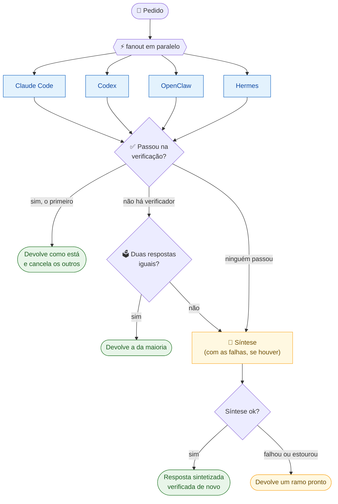

<div align="center">

# 🧩 Tessera

### Uma fonte, vários agentes, um resultado.

Orquestra **Claude Code**, **Codex**, **OpenClaw** e **Hermes** como se fossem um só:<br>
mesma configuração, a mesma tarefa em paralelo e a resposta que **se prova** em vez da que soa melhor.

<br>


[Início rápido](#-início-rápido) •
[Como decide](#-como-o-tessera-decide) •
[Comandos](#%EF%B8%8F-comandos) •
[Resultados](#-resultados-medidos) •
[Configuração](#%EF%B8%8F-configuração) •
[Diagnóstico](#-diagnóstico) •
[Roadmap](#%EF%B8%8F-roadmap)

</div>

---

## 📌 Em uma frase

O Tessera **não substitui** os agentes: ele chama os CLIs que já estão instalados, dispara a mesma tarefa em todos e devolve a primeira resposta que **passa nos testes**. Quando não há teste, devolve a resposta em que a maioria concorda. Só pede a um modelo para sintetizar quando não há outro jeito de decidir.

<table>
<tr>
<td width="25%" align="center">🔄<br><b>sync</b><br><sub>uma configuração para os quatro agentes</sub></td>
<td width="25%" align="center">⚡<br><b>fanout</b><br><sub>todos em paralelo, vence quem se prova</sub></td>
<td width="25%" align="center">🔗<br><b>pipeline</b><br><sub>a saída de um alimenta o próximo</sub></td>
<td width="25%" align="center">📊<br><b>eval</b><br><sub>cada agente sozinho contra o Tessera</sub></td>
</tr>
</table>

---

## 🚦 Estado atual

> [!IMPORTANT]
> **Em 4 rodadas do conjunto difícil, o Tessera empata com o melhor agente sozinho: 26,0 contra 26,3 do OpenClaw (de 33).** Quando decide, acerta 93%; perde nas 14% das tarefas em que nenhum ramo fica pronto no prazo. Esse é o próximo alvo.

| Parte | Situação | Evidência |
|:---|:---:|:---|
| Sincronização (`sync`, `doctor`) | ✅ | Testes de idempotência, preservação de conteúdo e conflitos |
| `pipeline`, `do`, barramento | ✅ | Testes com agente falso (`test/fake-agent.mjs`) |
| `fanout`: verificação, maioria, síntese, fallback | ✅ | Testes unitários + rodadas reais com os quatro agentes |
| Prazo por ramo (mata o grupo de processos) | ✅ | Teste de regressão: um neto que dorme 30 s já não segura o fanout |
| Mangaba Router como provedor único | ✅ | Os quatro agentes rodam por ele, sem login próprio |
| Claude Code · Codex · OpenClaw | ✅ | `mangaba-agente-rapido`, respostas em 6 a 36 s |
| Hermes | ⚠️ | O mais instável: de 11 a 27 acertos por rodada |
| **Tessera melhor que cada agente** | 🟨 **Empate** | 26,0 contra 26,3 do OpenClaw, média de 4 rodadas. Ver [resultados](#-resultados-medidos) |
| Latência p95 ≤ 1,5× o melhor agente | ❌ | 3,7× (180 s contra 49 s) |

---

## 🚀 Início rápido

> **Requisitos:** Node.js 20 ou superior. Nenhuma dependência para instalar.

```bash
git clone https://github.com/dheiver2/tessera.git
cd tessera
npm test
```

```bash
node bin/tessera.mjs doctor
```

```bash
node bin/tessera.mjs fanout --prompt "Qual a complexidade da busca binária? Responda em 1 linha."
```

<details>
<summary><b>Deixar o comando <code>tessera</code> disponível no terminal</b></summary>

```bash
npm link
```

Depois disso, `tessera fanout ...` funciona de qualquer pasta.
</details>

<details>
<summary><b>Usar o Mangaba Router como provedor dos quatro agentes</b></summary>

A chave vem de `MANGABA_ROUTER_KEY` ou, na falta dela, de `~/.tessera/router.key`. O arquivo fica fora do repositório, com permissão 600.

```bash
mkdir -p ~/.tessera && chmod 700 ~/.tessera
```

```bash
read -rs MANGABA_ROUTER_KEY && printf %s "$MANGABA_ROUTER_KEY" > ~/.tessera/router.key && chmod 600 ~/.tessera/router.key
```

> [!CAUTION]
> A chave **nunca** vai para o repositório. Para usar a configuração própria de cada agente, passe `--no-provider`.
</details>

---

## 🧠 Como o Tessera decide



| Ordem | Caminho | Quando | Custo |
|:---:|:---|:---|:---|
| 1️⃣ | **Verificação** | Há `--verify "cmd"` (no eval, os testes públicos da tarefa) | O mais barato: a primeira resposta aprovada encerra o fanout |
| 2️⃣ | **Maioria** | Sem verificador, duas respostas normalizadas coincidem | Barato: nenhum modelo extra |
| 3️⃣ | **Síntese** | Impasse. Com verificador, vira **correção** a partir das falhas | O mais caro: uma chamada a mais |
| 🛟 | **Fallback** | A síntese falhou ou estourou o prazo | Devolve um ramo pronto em vez de nada |

> [!TIP]
> **Por que não sintetizar sempre?** Na primeira medição, a síntese reescreveu uma solução correta e introduziu um erro de sintaxe, além de responder por metade da latência. Um modelo que reescreve é um seletor fraco. Um teste que passa é um seletor forte.

---

## 🛠️ Comandos

### 🔄 `sync`: uma configuração para todos

A fonte única fica no repositório:

```text
core/AGENTS.md          regras compartilhadas
core/SOUL.md            identidade
core/USER.md            preferências do usuário
skills/<nome>/SKILL.md  skills (name + description no frontmatter)
mcp/servers.json        servidores MCP (command/args/env ou url)
framework.json          alvos, roteamento, fanout e provedor
```

```bash
node bin/tessera.mjs sync --dry-run --root ~/meu-projeto
```

```bash
node bin/tessera.mjs sync --root ~/meu-projeto
```

```bash
node bin/tessera.mjs sync --global --target claude,codex
```

| Alvo | Instruções | Persona | Skills | MCP |
|:---|:---|:---|:---|:---|
| **Claude Code** | `CLAUDE.md` | dentro de `CLAUDE.md` | `.claude/skills/` | `.mcp.json` |
| **Codex** | `AGENTS.md` | dentro de `AGENTS.md` | `.agents/skills/` | `.codex/config.toml` |
| **OpenClaw** | `AGENTS.md` (workspace) | `SOUL.md`, `USER.md` | `skills/` | snippet para `openclaw.json` |
| **Hermes** | `AGENTS.md` | `SOUL.md` | `skills/` | snippet para `config.yaml` |

<details>
<summary><b>🔒 Garantias de escrita</b></summary>

- O conteúdo gerado fica entre marcadores (`<!-- tessera:begin -->`). O que você escreveu fora deles não é tocado.
- Antes de alterar um arquivo existente, a cópia vai para `~/.tessera/backups/<data>/`.
- Rodar de novo sem mudanças não grava nada.
- Uma skill criada à mão (sem o marcador `.tessera-managed`) só é sobrescrita com `--force`.
- Se um `[mcp_servers.<nome>]` já existe fora do bloco, o Tessera reporta conflito em vez de duplicar.

> [!NOTE]
> Os caminhos seguem a convenção de cada agente. No OpenClaw e no Hermes, o MCP sai como snippet: confira nas versões instaladas antes de aplicar.
</details>

### ⚡ `fanout`: todos ao mesmo tempo

```bash
node bin/tessera.mjs fanout --prompt "Esta função tem bug de concorrência? <código>"
```

```bash
node bin/tessera.mjs fanout --prompt "Implemente solve() em JS" --verify "node checa.mjs"
```

O comando de `--verify` recebe a resposta pelo **stdin** e o nome do agente em `TESSERA_AGENT`. Código de saída 0 significa aprovado.

| Flag | Padrão | Função |
|:---|:---:|:---|
| `--agents a,b,c` | os quatro | quais agentes disparar |
| `--verify "cmd"` | — | verificador; a primeira resposta aprovada vence |
| `--no-vote` | — | desliga a decisão por maioria |
| `--roles` | desligado | dá um foco diferente a cada agente |
| `--synth nome` | `claude` | quem sintetiza ou corrige |
| `--deadline s` | `120` | prazo de cada ramo |
| `--synth-timeout s` | `180` | prazo da síntese |
| `--quorum n` · `--grace s` | `2` · `15` | com *n* respostas boas, espera *s* segundos e cancela o resto |
| `--max-wait s` | `30` | espera máxima depois da primeira resposta |
| `--no-provider` | — | usa a configuração própria de cada agente |

<details>
<summary><b>⏱️ Como a latência é limitada</b></summary>

- **Pior caso:** `deadline + synth-timeout`, mesmo com um agente travado.
- Cada ramo roda num **grupo de processos próprio**. Ao estourar o prazo ou ser cancelado, o grupo inteiro recebe SIGTERM e, 3 s depois, SIGKILL. Subprocessos do agente não conseguem mais segurar o fanout.
- Um ramo que estoura o prazo vira falha, e o fanout segue com os outros. O fanout só falha se **nenhum** responder.
- Cada resposta é cortada em `maxCharsPerBranch` (6000) antes da síntese.

Formato da saída com `--verify` (ids encurtados):

```text
[done] openclaw 10912ms (…)  verificação: passou
[cancelled] claude 11020ms (…)  — dispensado (já havia resposta escolhida)
[cancelled] codex 11024ms (…)  — dispensado (já havia resposta escolhida)
[cancelled] hermes 11031ms (…)  — dispensado (já havia resposta escolhida)
ramos: 11031ms  provedor: mangaba-router

=== resposta final (openclaw passou na verificação, sem síntese, 11040ms no total) ===
```
</details>

### 🔗 `pipeline`: encadear agentes

`{{previous}}` é trocado pela saída do passo anterior. O pipeline **para no primeiro passo que falha**.

```json
{
  "steps": [
    { "name": "analise", "agent": "codex",  "prompt": "Liste riscos de correção no código." },
    { "name": "revisao", "agent": "claude", "prompt": "Confirme ou descarte cada ponto:\n\n{{previous}}" },
    { "name": "resumo",  "agent": "hermes", "prompt": "Resuma em 10 linhas:\n\n{{previous}}" }
  ]
}
```

```bash
node bin/tessera.mjs pipeline pipelines/revisar-e-resumir.json
```

### 🎯 `do` e `delegate`: um agente só

```bash
node bin/tessera.mjs do --kind codigo --prompt "implemente a função X em src/x.js"
```

```bash
node bin/tessera.mjs delegate --agent codex --prompt "explique este erro"
```

O `do` escolhe o agente pelo tipo de tarefa (`framework.json > routing`):

| Tipo | `codigo` | `revisao` | `resumo` | `automacao` |
|:---|:---:|:---:|:---:|:---:|
| Agente | Codex | Claude | Hermes | OpenClaw |

> [!WARNING]
> Esse roteamento ainda é uma **hipótese**, não uma medição. Os dados do eval vão substituí-lo (Fase 3 do [plano](docs/PLANO.md)).

### 📊 `eval`: medir em vez de presumir

Roda as mesmas tarefas em cada agente sozinho e no Tessera, dá a nota **sem usar modelo** e compara.

```bash
node bin/tessera.mjs eval
```

```bash
node bin/tessera.mjs eval --tasks evals/tasks-dificeis.json
```

```bash
node bin/tessera.mjs eval --limit 5 --kind code --modes openclaw,tessera
```

| Conjunto | Tarefas | Código | Perguntas | Revisão |
|:---|:---:|:---:|:---:|:---:|
| [`evals/tasks.json`](evals/tasks.json) | 34 | 14 | 14 | 6 |
| [`evals/tasks-dificeis.json`](evals/tasks-dificeis.json) | 33 | 14 | 11 | 8 |

<details>
<summary><b>🧪 Como a nota é dada</b></summary>

- **Código:** a função `solve` roda contra testes. O Tessera **vê só a primeira metade** dos testes para verificar; a nota usa **todos**, para a verificação não virar cola.
- **Perguntas:** regex de aceite e de rejeição (pega pegadinhas como `9.11 > 9.9`).
- **Revisão:** o bug conhecido precisa ser apontado.
- **Sandbox:** `node --permission`, leitura só do próprio arquivo, sem rede, sem processos filhos, ambiente mínimo (nenhuma variável do processo vaza) e fuso fixo.
- **Padrões proibidos:** tarefas como a de expressão reprovam se usarem `eval` ou `Function`.
- **Conjunto difícil:** cada tarefa tem uma solução de referência que passa e, quando faz sentido, uma solução ingênua que reprova (`test/eval-dificeis.test.mjs`).
- **Execução sequencial** por padrão, para a latência de um modo não inflar a do outro.
- **Saída:** `evals/resultados/<data>.json` e `.md`, com acerto por modo e por tipo, p50/p95, oráculo, caminho de decisão e tarefas ganhas e perdidas.
</details>

---

## 📈 Resultados medidos

> Todos os agentes com `mangaba-agente-rapido` pelo Mangaba Router, síntese pelo Claude. Diferenças de uma tarefa estão dentro do ruído.

### 🎲 Conjunto difícil · 4 rodadas com o prazo corrigido · 05–06/nov/2026

| Modo | Por rodada | Média | Desvio | p95 médio |
|:---|:---:|:---:|:---:|---:|
| **openclaw** | 26 · 27 · 25 · 27 | **26,3/33** | **1,0** | **49 s** |
| 🧩 **tessera** | 26 · 27 · 28 · 23 | **26,0/33** | 2,2 | 180 s |
| claude | 25 · 25 · 25 · 20 | 23,8/33 | 2,5 | 120 s |
| codex | 21 · 20 · 21 · 20 | 20,5/33 | 0,6 | 120 s |
| hermes | 11 · 25 · 27 · 19 | 20,5/33 | 7,2 | 122 s |

> [!IMPORTANT]
> **Veredito: empate com o OpenClaw.** A diferença de 0,3 tarefa é muito menor que o desvio entre rodadas. O Tessera é melhor que Claude, Codex e Hermes sozinhos, mas não é melhor que o melhor agente, e leva 3,7× mais tempo no p95.

**Onde o Tessera perde, somando as 4 rodadas (132 tarefas):**

| Caminho | Tarefas | Acerto |
|:---|:---:|:---:|
| ✅ verificação | 37 | 34/37 |
| 🧪 síntese | 36 | 34/36 |
| 🗳️ maioria | 34 | 32/34 |
| 1️⃣ resposta única | 5 | 4/5 |
| 🔧 correção pela síntese | 1 | 0/1 |
| 🛟 ramo pronto (síntese falhou) | 6 | **0/6** |
| ⛔ sem resposta | 13 | **0/13** |

Quando o Tessera chega a decidir, acerta 104 de 112 (93%). **As derrotas vêm de não responder:** em 19 tarefas (14%) nenhum ramo ficou pronto no prazo ou a síntese estourou o tempo. Com os quatro agentes chamando o roteador ao mesmo tempo, cada um fica mais lento que sozinho. Esse é o próximo alvo: limitar chamadas simultâneas e dar ao fanout um prazo próprio.

As tarefas que pegaram o Mac dormindo (4 de 132) foram refeitas e substituídas. A agregação está em [`evals/agregar.mjs`](evals/agregar.mjs).

<details>
<summary><b>🔥 Conjunto difícil · rodada 2 em detalhe · prazo corrigido</b></summary>

| Modo | Acerto | Respondeu | p50 | p95 | 💻 Código | ❓ Perguntas | 🔍 Revisão |
|:---|:---:|:---:|---:|---:|:---:|:---:|:---:|
| claude | 25/33 · 75,8% | **30/33** | 12,0 s | 120,2 s | **9/14** | 9/11 | 7/8 |
| codex | 21/33 · 63,6% | 28/33 | 12,2 s | 120,0 s | 5/14 | 8/11 | **8/8** |
| **openclaw** | **26/33 · 78,8%** | 28/33 | **11,5 s** | **54,3 s** | **9/14** | **10/11** | 7/8 |
| hermes | 11/33 · 33,3% | 12/33 | 121,7 s | 122,5 s | 4/14 | 2/11 | 5/8 |
| 🧩 **tessera** | **26/33 · 78,8%** | **30/33** | 37,6 s | 121,8 s | **9/14** | 9/11 | **8/8** |

Oráculo (pelo menos um agente sozinho acertou): 31/33. Algum ramo do fanout acertou: 27/33.

**Como o Tessera decidiu:**

| Caminho | Tarefas | Acerto | p50 |
|:---|:---:|:---:|---:|
| ✅ verificação | 10 | 9/10 | 34,5 s |
| 🧪 síntese | 11 | **10/11** | 40,3 s |
| 🗳️ maioria | 8 | 7/8 | 12,9 s |
| 🔧 correção pela síntese | 1 | 0/1 | 192,9 s |
| ⛔ sem resposta | 3 | 0/3 | 121,8 s |

<table>
<tr>
<td width="50%" valign="top">

**✅ O que a correção do prazo resolveu**

- p95 do Tessera: **302 s → 122 s**; p50: 48 s → 38 s
- Nenhum ramo passou de 120 s
- Tessera ganhou do OpenClaw em `hard-atoi` e `hard-review-map-parseint`

</td>
<td width="50%" valign="top">

**💥 As 7 derrotas do Tessera**

- ⛔ **3 tarefas** sem nenhum ramo no prazo. Em duas delas um agente sozinho respondeu: com quatro chamadas ao mesmo tempo, o roteador fica mais lento
- ✅ `hard-semver`: a verificação aceitou uma solução que passou nos testes públicos e falhou nos privados (6/8)
- 🗳️ `hard-qa-parseint`: maioria errada de novo, 2 × "0" (o mesmo erro da rodada 1)
- 🧪 `hard-qa-coercao`: a síntese errou, embora dois ramos estivessem certos
- 🔧 `hard-inverter-grafemas`: a correção não consertou

</td>
</tr>
</table>

> [!NOTE]
> **Uma rodada não basta.** Entre as rodadas 1 e 2, o Codex caiu de 25 para 21 e o OpenClaw subiu de 21 para 26, com as mesmas tarefas. Esse ruído de 4 a 5 tarefas é maior que qualquer vantagem medida até aqui. Por isso foram feitas mais 3 rodadas (acima).

</details>

<details>
<summary><b>🔥 Conjunto difícil · rodada 1 · com o bug do prazo</b></summary>

| Modo | Acerto | Respondeu | p50 | p95 | 💻 Código | ❓ Perguntas | 🔍 Revisão |
|:---|:---:|:---:|---:|---:|:---:|:---:|:---:|
| claude | 22/33 · 66,7% | 26/33 | 23,0 s | 120,5 s | 7/14 | 7/11 | 8/8 |
| **codex** | **25/33 · 75,8%** | 28/33 | 13,3 s | 120,0 s | 7/14 | **10/11** | 8/8 |
| openclaw | 21/33 · 63,6% | 28/33 | **12,2 s** | **82,8 s** | 6/14 | 7/11 | 8/8 |
| hermes | 19/33 · 57,6% | 24/33 | 83,8 s | 121,9 s | 7/14 | 7/11 | 5/8 |
| 🧩 **tessera** | **25/33 · 75,8%** | **29/33** | 48,1 s | 302,1 s | **9/14** | 8/11 | 8/8 |

**Como o Tessera decidiu:**

| Caminho | Tarefas | Acerto | p50 |
|:---|:---:|:---:|---:|
| ✅ verificação | 9 | **9/9** | 64,3 s |
| 🧪 síntese | 9 | **9/9** | 43,2 s |
| 🗳️ maioria | 5 | 4/5 | 12,7 s |
| 1️⃣ resposta única | 4 | 3/4 | 84,2 s |
| 🔧 correção pela síntese | 1 | 0/1 | 181,6 s |
| 🛟 ramo pronto (síntese falhou) | 1 | 0/1 | 302,1 s |
| ⛔ sem resposta | 4 | 0/4 | 121,8 s |

<table>
<tr>
<td width="50%" valign="top">

**🏆 Onde o Tessera ganhou do Codex**

- `hard-expressao`: **nenhum** agente sozinho acertou; a correção pela síntese chegou a 8/8
- `hard-dia-semana`
- `hard-topo-lexico`
- `hard-inverter-grafemas`
- `hard-qa-sextas-13`

</td>
<td width="50%" valign="top">

**💥 Onde perdeu**

- ⛔ **4 tarefas:** nenhum ramo respondeu no prazo (roteador saturado com 4 chamadas ao mesmo tempo)
- 🗳️ `hard-qa-parseint`: maioria errada, 2 × "0" contra 1 × "5"
- 1️⃣ `hard-qa-sort-js`: a única resposta que chegou estava errada
- 🔧 `hard-csv-linha`, `hard-semver`: a correção não consertou

</td>
</tr>
</table>

> [!WARNING]
> **Bug encontrado nesta rodada, corrigido na rodada 2.** O prazo de 120 s não era cumprido: só o processo do agente recebia o sinal, e os subprocessos dele seguravam a saída. Houve ramos de 499 s e de 1080 s, o que inflou o p95 de todos os modos.

</details>

<details>
<summary><b>📜 Histórico: Fase 0 e Fase 1 no conjunto original (34 tarefas)</b></summary>

#### Fase 0 · síntese sempre

| Modo | Acerto | p50 | p95 |
|:---|:---:|---:|---:|
| claude | 31/34 · 91,2% | 7,1 s | 105,6 s |
| codex | 31/34 · 91,2% | 8,2 s | 107,4 s |
| **openclaw** | **33/34 · 97,1%** | **6,4 s** | **10,7 s** |
| hermes | 29/34 · 85,3% | 31,7 s | 122,0 s |
| tessera | 33/34 · 97,1% | 55,0 s | 149,4 s |

- A única derrota do Tessera foi a síntese quebrando uma solução certa.
- A síntese respondia por metade do tempo do Tessera.

#### Fase 1 · verificação → maioria → síntese

| Modo | Acerto | p50 | p95 |
|:---|:---:|---:|---:|
| claude | 33/34 · 97,1% | 6,9 s | 113,5 s |
| codex | 31/34 · 91,2% | 8,4 s | 47,0 s |
| **openclaw** | **34/34 · 100%** | 9,4 s | **13,2 s** |
| hermes | 29/34 · 85,3% | 23,9 s | 121,9 s |
| tessera | 33/34 · 97,1% | 23,0 s | 137,2 s |

- No Tessera, código foi de 13/14 para **14/14** e o p50 caiu de **55 s para 23 s**.
- O OpenClaw fez 100%: o conjunto tinha teto, e isso motivou o conjunto difícil.

Resultados brutos em [`evals/resultados/`](evals/resultados/).
</details>

<details>
<summary><b>🩹 O que as medições mudaram no código</b></summary>

| Problema encontrado | Correção |
|:---|:---|
| A síntese reescrevia respostas certas | Seleção por verificação e maioria; síntese só no impasse |
| Síntese que estoura o prazo deixava o fanout vazio | Fallback para um ramo pronto |
| Papéis mudavam o formato das respostas objetivas | Papéis desligados por padrão (`--roles`) |
| Subprocessos do agente seguravam o fanout além do prazo | Grupo de processos próprio + SIGKILL no grupo |
| Plugins e hooks do usuário contaminavam o Claude | `--bare` quando há provedor |
| `--tools ""` engolia o prompt do Claude | Prompt por stdin |
| Duas execuções na mesma sessão travavam o OpenClaw | `--session-id` novo por chamada |
| Logs do OpenClaw entravam como resposta | Limpeza de linhas `[subsistema] ...` |
| OpenClaw dizia "couldn't generate a response" com código 0 | Tratado como falha |
| Codex com `mangaba-coder` devolvia mensagem vazia | Modelo trocado para `mangaba-agente-rapido` |
| Hermes travava com `mangaba-flash` | Modelo trocado; raciocínio oculto no `config.yaml` |
</details>

---

## ⚙️ Configuração

### 🌐 Provedor compartilhado (Mangaba Router)

Com `provider` em `framework.json`, os quatro agentes usam o mesmo roteador, **sem login próprio** e **sem alterar a configuração global** de cada um:

| Agente | Como é apontado ao roteador |
|:---|:---|
| **Claude Code** | `--bare`; `ANTHROPIC_BASE_URL` e `ANTHROPIC_API_KEY` só no processo; prompt por stdin; `--tools ""` |
| **Codex** | `-c model_provider=tessera` e `-c model_providers.tessera.*` na linha de comando |
| **OpenClaw** | `--model router/<modelo>` e uma `--session-id` nova por chamada |
| **Hermes** | `--provider mangaba-router`, que lê a chave de `MANGABA_ROUTER_KEY` |

> [!NOTE]
> OpenClaw e Hermes precisam, uma vez, do provedor na configuração deles: modelos permitidos em `openclaw.json` e o bloco `providers.mangaba-router` no `config.yaml` do Hermes.

### 🔧 Trocar o comando de um agente

Defina `TESSERA_<AGENTE>_CMD`. O prompt é anexado como último argumento. Para argumentos com espaço ou aspas, use JSON:

```bash
export TESSERA_CODEX_CMD="codex exec --skip-git-repo-check --full-auto"
```

```bash
export TESSERA_CLAUDE_CMD='["claude", "-p", "--tools", ""]'
```

<details>
<summary><b>Comandos padrão de cada agente</b></summary>

| Agente | Sem provedor | Com provedor |
|:---|:---|:---|
| claude | `claude -p --tools ""` (stdin) | `claude --bare -p --tools ""` (stdin) |
| codex | `codex exec --skip-git-repo-check <prompt>` | idem + `-c model_provider=tessera ...` e `-m <modelo>` |
| openclaw | `openclaw agent --local --agent main --session-id <novo> --thinking off --message <prompt>` | idem + `--model <modelo>` |
| hermes | `hermes chat -Q -q <prompt>` | idem + `--provider mangaba-router -m <modelo>` |

- **Claude sem ferramentas:** com as ferramentas padrão, o prompt inicial é grande e domina o tempo. Para tarefas que precisam delas, troque o comando.
- **OpenClaw exige um agente:** passe `--agent-id main` (ou o seu id) em qualquer comando.
</details>

---

## 🩺 Diagnóstico

| Sintoma | Causa provável | O que fazer |
|:---|:---|:---|
| `OAuth session expired` no Claude | login vencido | rodar `claude` e entrar de novo, ou usar o provedor |
| `401 chave inválida ou revogada` | chave revogada | gerar chave nova e regravar `~/.tessera/router.key` |
| `Not inside a trusted directory` no Codex | pasta fora de um repositório git | já tratado: o adaptador passa `--skip-git-repo-check` |
| `Pass --to ... or --agent` no OpenClaw | falta o id do agente | passar `--agent-id main` |
| `Agent couldn't generate a response` | OpenClaw sem resposta do modelo | tratado como falha; o fanout segue com os outros |
| `não foi possível executar "hermes"` | CLI fora do PATH | instalar o Hermes ou ajustar `TESSERA_HERMES_CMD` |
| `tempo esgotado após Ns` | agente ou roteador lento | aumentar `--deadline` ou tirar o agente com `--agents` |
| `conflict` no `sync` | `[mcp_servers.x]` duplicado fora do bloco | remover a definição duplicada à mão |

O histórico de execuções fica em `.tessera/bus/tasks/*.json`, com status, saída, erro e duração:

```bash
node bin/tessera.mjs tasks
```

---

## 🗺️ Roadmap

| | Etapa | Situação |
|:---:|:---|:---|
| ✅ | **Fase 0**: medir antes de otimizar (`eval`) | Concluída |
| ✅ | **Fase 1**: seleção por verificação e maioria | Implementada, sem worktrees |
| ✅ | Conjunto difícil, rodada 2 com o prazo corrigido | Concluída: empate, 26/33 |
| ✅ | Conjunto difícil, 4 rodadas | Concluída: empate, 26,0 contra 26,3 |
| ⏭️ | Limite de chamadas simultâneas ao roteador e prazo próprio do fanout (14% sem resposta) | Próximo |
| ⏭️ | Maioria mais exigente (não aceitar empate 2 × 2) e checagem da resposta única | Depois |
| ⏭️ | **Fase 2**: concordância em texto livre sem síntese | Planejada |
| ⏭️ | **Fase 3**: roteamento aprendido com os dados do eval | Planejada |
| ⏭️ | **Fase 4**: disjuntor por agente e limite de chamadas simultâneas ao roteador | Planejada |
| ⏭️ | git worktrees para agentes que editam arquivos; CI | Planejada |

O plano completo, com critérios de pronto, está em [`docs/PLANO.md`](docs/PLANO.md).

---

## 📁 Estrutura

```text
tessera/
├── bin/tessera.mjs          CLI
├── src/
│   ├── bridge.mjs           agentes, fanout, verificação, maioria, síntese
│   ├── eval.mjs             tarefas, sandbox, nota e relatório
│   ├── sync.mjs · writer.mjs · canonical.mjs
├── core/ · skills/ · mcp/   fonte única da configuração
├── evals/
│   ├── tasks.json           34 tarefas
│   ├── tasks-dificeis.json  33 tarefas com armadilha
│   └── resultados/          relatórios .json e .md de cada rodada
├── pipelines/               exemplos de pipeline
├── docs/PLANO.md            plano por fases
└── test/                    60 testes (node:test)
```

---

<div align="center">

**MIT** · feito por [@dheiver2](https://github.com/dheiver2)

</div>
